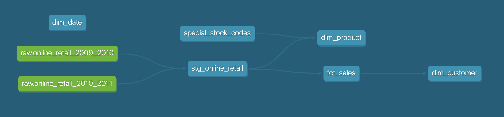

# Online Retail dbt Project

## What the project is about

A dbt project that transforms raw online retail transaction data into a dimensional star schema, built on DuckDB with BigQuery as planned target.

## Why this project

I wanted to learn data modeling properly. I'm reading Kimball's *The Data Warehouse Toolkit* and Adamson's *Star Schema: The Complete Reference*, which help me with the theory. Also, analytics engineering interests me because I like exploring and working with data, I know the cost of bad data, and I'm interested in software engineering. So, I decided to try this data set. It has only a handful of fields, which makes it easier for a first project, and learning by doing gives me hands-on experience with dbt, DuckDB and BigQuery.

## What I learned

Through this project, I learned

- how to structure a dbt project
- again, the importance of understanding the data I'm working on
- writing tests and docs, paired with version control in Git and GitHub
- working locally with DuckDB

## Overview

The screenshot shows a lineage from raw data into a dimensional star schema.



## Models

**staging**

- `stg_online_retail` - one row per invoice line, overlap removed and duplicates flagged.

**marts**

- `fct_sales` - one row per invoice line, cancellations flagged and line amount calculated.
- `dim_product` - one row per stock code with classified product categories from seed and product flagged.
- `dim_customer` - one row per customer id, with first and last purchase dates and net revenue.
- `dim_date` - one row per day; dates from 2009-01-01 to 2011-12-31, with date part information.

## Seeds

Why seeds? It replaces messy SQL `CASE` statements. Also, since it's inside the project, I can write tests and docs. And, everyone who's working together on this project will have a consistent reference to them.

- `special_stock_codes` - non-product codes, classified for product categories and includes reasons for each code, showing where I made assumptions.

## About data and download link

Online Retail II is a real data set that includes transactions occurring for a UK-based, non-store online retailer between 2009-12-01 and 2011-12-09. You can download the zip file here: https://archive.ics.uci.edu/dataset/502/online+retail+ii

## Decisions taken along the way

A summary of the core data cleaning and modeling choices made in this project, along with the SQL queries used to investigate and resolve them:

- **Overlapped records:** Removed the date range overlap between the two source files.
- **Duplicates:** Flagged identical rows while keeping them as potential repeat scans.
- **Several descriptions per stock code:** Resolved conflicting stock code descriptions using usage frequency.
- **Null customer IDs:** Mapped missing IDs to 'unknown' in the fact table.
- **Non-product codes:** Isolated 26 special non-product codes into a seed table.

### Overlapped records

I looked into the dataset and found that there were overlapped records between 2010-12-01 and 2010-12-09. So, I wrote a SQL query to count the overlapped records in each source file.

```sql
SELECT 'online_retail_2009_2010' AS source_file, COUNT(*)
FROM raw.online_retail_2009_2010
WHERE strptime(InvoiceDate, '%m/%d/%Y %H:%M') >= '2010-12-01'
UNION ALL
SELECT 'online_retail_2010_2011' AS source_file, COUNT(*)
FROM raw.online_retail_2010_2011
WHERE strptime(InvoiceDate, '%m/%d/%Y %H:%M') < '2010-12-10';
```

Both files had 22,523 rows for those days. Matching counts don't prove the rows are the same, so I compared the rows themselves with `EXCEPT ALL`, in both directions. Both returned 0 rows, so the overlap is identical in both files.

```sql
-- rows in the 2009-2010 overlap that are missing from 2010-2011
SELECT * FROM raw.online_retail_2009_2010
WHERE strptime(InvoiceDate, '%m/%d/%Y %H:%M') >= '2010-12-01'
EXCEPT ALL
SELECT * FROM raw.online_retail_2010_2011
WHERE strptime(InvoiceDate, '%m/%d/%Y %H:%M') < '2010-12-10';

-- rows in the 2010-2011 overlap that are missing from 2009-2010
SELECT * FROM raw.online_retail_2010_2011
WHERE strptime(InvoiceDate, '%m/%d/%Y %H:%M') < '2010-12-10'
EXCEPT ALL
SELECT * FROM raw.online_retail_2009_2010
WHERE strptime(InvoiceDate, '%m/%d/%Y %H:%M') >= '2010-12-01';
```

I kept the 2009-2010 copy and filtered the overlap out of the 2010-2011 file in `stg_online_retail`.

### Duplicates

I also found identical records within a single source file. To test this, the following query was used. The query leaves out `is_duplicate`, since its value differs between copies.

```sql
SELECT * EXCLUDE (is_duplicate), COUNT(*) FROM main.stg_online_retail
GROUP BY ALL
HAVING COUNT(*) > 1
ORDER BY COUNT(*) DESC;
```

It returned 11,001 duplicated groups. Some groups have more than two copies, so there are 11,812 extra rows in total. To flag this, I added a boolean `is_duplicate` column. The first copy in each group is `false` and the extra copies are `true`.

```sql
SELECT is_duplicate, COUNT(*) FROM main.stg_online_retail
GROUP BY is_duplicate;
```

I kept them instead of deleting, as they may be real repeat scans and the timestamp only goes to the minute. With the flag, the user can filter them during analysis, such as `is_duplicate = false`.

### Several descriptions per stock code

I also noticed that some stock codes had more than one description. To produce a product table, each stock code needs one description. So, I first looked into how many times each description appears and then applied a row number that is partitioned by stock code, ordered by usage count and description, both descending.

```sql
-- check if each stock code has more than one description
SELECT stock_code, COUNT(DISTINCT description) FROM main.stg_online_retail
GROUP BY stock_code
HAVING COUNT(DISTINCT description) > 1;

-- count the usage of each non-null description, then keep one per stock code
WITH description_count AS (
    SELECT
        stock_code,
        description,
        COUNT(*) AS usage_count
    FROM main.stg_online_retail
    WHERE description IS NOT NULL
    GROUP BY stock_code, description
)

SELECT
    stock_code,
    description
FROM description_count
QUALIFY ROW_NUMBER() OVER (
    PARTITION BY stock_code
    ORDER BY usage_count DESC, description DESC
) = 1;
```

### Null customer IDs

Some records might not have customer IDs. I confirmed it and there were 235,287 records without customer IDs (this is after overlapped records removal). In `fct_sales`, I then set their customer ID to `unknown`, so that it makes it easier for downstream users to filter or use them properly.

```sql
-- check the number of records without customer IDs
SELECT COUNT(*) FROM main.stg_online_retail
WHERE customer_id IS NULL;
```

### Non-product codes

I came upon this by accident while checking cancellations. I checked if any cancellation had a positive quantity in `fct_sales` and one row came back with `stock_code = 'M'`, which is a manual adjustment. That showed that not every stock code is a product. I knew that real product codes start with digits so I pulled the ones that don't and it returned 62 codes. I looked at those codes with their descriptions from `dim_product` and it showed that a pattern rule wasn't enough; many codes that start with `DCGS` were also real products and I kept `ebay` ones as products as well. That left 26 codes which went into the `special_stock_codes` seed with a reason each.

```sql
-- check cancellations with a positive quantity
SELECT * FROM main.fct_sales
WHERE is_cancellation = true AND quantity > 0;

-- list codes that don't look like products
SELECT DISTINCT stock_code FROM main.fct_sales
WHERE NOT regexp_matches(stock_code, '^[0-9]');
```

## Tests

- Not null and unique
- Relationships - they are used to see if the values from one table are present in another. Relationship tests in the project relate from `fct_sales` to
  - `dim_product` on `stock_code`
  - `dim_customer` on `customer_id`
  - `dim_date` on `invoice_date`
- Accepted values - they are used to only allow the values from a list and therefore the test will fail if the value is not one of the values from the list. I used `accepted_values` test for `product_category` in the `dim_product` model.

## How to run

1. Clone the repo, then run `uv sync`.
2. Download the data and save the two sheets as CSVs in `data/`: `raw_2009_2010.csv` and `raw_2010_2011.csv`. Format `InvoiceDate` as `m/d/yyyy h:mm` (4-digit year) before saving.
3. Run `uv run load_raw.py` from the project folder to load the CSVs into DuckDB.
4. Run `uv run dbt deps` for dependencies.
5. Then `uv run dbt build` will handle everything (`dbt seed`, `dbt run`, `dbt test`).

> **_NOTE:_** The `profiles.yml` is in the project root, so no extra setup is needed.

> **_NOTE:_** `uv run dbt docs generate` to produce lineage, and `uv run dbt docs serve` to see the lineage and docs on a local site.

### Troubleshooting

On macOS, `uv sync` may fail with `SSL: CERTIFICATE_VERIFY_FAILED` while building `dbt-core-experimental-parser`. Its build step downloads a file from GitHub, and Python can't find the Mac's trusted certificates. Point Python to them, then run `uv sync` again:

```bash
export SSL_CERT_FILE=/etc/ssl/cert.pem
# to make it permanent, append the same line to `~/.zshrc`.
echo 'export SSL_CERT_FILE=/etc/ssl/cert.pem' >> ~/.zshrc
# reload the shell configuration
source ~/.zshrc
```

## Next steps

- I will continue with pushing this to BigQuery as my next phase.
- I may use Power BI or Tableau for the visualization layer.